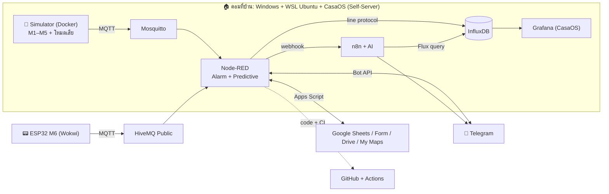

# 🏭 Smart Factory Monitoring & AI Maintenance Platform

Mini-Project วิชา **030143375 อินเตอร์เน็ตของสรรพสิ่งสำหรับงานอุตสาหกรรม (IoT for Industrial)**

ระบบเฝ้าระวังเครื่องจักรในโรงงานแบบครบวงจร ตั้งแต่เครื่องจักร (จำลอง) → เก็บข้อมูล → Dashboard → แจ้งเตือนล่วงหน้าก่อนเครื่องพัง → ใบแจ้งซ่อม → สั่งเดินเครื่องกลับอัตโนมัติ → AI สรุปรายงาน ทำงานบน **คอมพิวเตอร์ 1 เครื่อง + Cloud** ไม่ต้องต่อฮาร์ดแวร์จริง

ใช้เนื้อหาหลัก **3 สัปดาห์ (W10 Data-Cloud, W11 Private Server, W12 GitHub/Docker/n8n) ครบ 12 วัตถุประสงค์** ดูตารางตรวจสอบได้ที่ [docs/01-traceability.md](docs/01-traceability.md)

---

## สถาปัตยกรรมระบบ



## จุดเด่น

| ฟีเจอร์ | รายละเอียด |
|---|---|
| ตัวจำลองเครื่องจักรสมจริง | 5 เครื่อง + ESP32 บน Wokwi, มีโหมดเสีย 3 แบบ: ลูกปืนสึก / ร้อนเกิน / ชิ้นงานติด, ระบบป้องกัน Trip อัตโนมัติ |
| OEE แบบโรงงานจริง | Availability × Performance × Quality รายเครื่องและทั้งโรงงาน |
| Predictive Maintenance | วิเคราะห์แนวโน้มค่าสั่น (Linear regression) แจ้งเตือนก่อนเครื่อง Trip พร้อมเวลาที่คาดการณ์ |
| ปิดลูปงานซ่อม | Telegram แจ้งเตือน → ปุ่มเปิด Google Form → ช่างกรอก "ซ่อมเสร็จ" → ระบบสั่งเดินเครื่องเอง |
| Telegram Bot สองทาง | `/status` `/oee` `/stop` `/run` `/fault` `/maint` `/repair` `/report` `/ask` |
| AI จากข้อมูลจริง | n8n ดึงข้อมูล InfluxDB ให้ AI สรุปรายงานกะ และตอบคำถามจากข้อมูลจริง |
| Grafana 2 หน้า | Engineer (สถานะ/อุณหภูมิ/ค่าสั่น ISO 10816/OEE) และ Executive (OEE A×P×Q, ไทม์ไลน์สถานะ) |
| รันไฟล์เดียว | `INSTALL-CASAOS.bat` / `START-CASAOS.bat` รัน 6 services บน WSL + CasaOS, เลือกพอร์ตว่างอัตโนมัติ + CI บน GitHub Actions |

## เริ่มใช้งานเร็ว

**Windows (แนะนำ):** ดับเบิลคลิก `INSTALL-CASAOS.bat` ครั้งแรก (ติดตั้ง WSL Ubuntu + CasaOS + 6 services) ครั้งต่อไปใช้ `START-CASAOS.bat` และทดสอบเครื่องเสียด้วย `TEST-FAULT.bat`

**WSL Ubuntu โดยตรง:**

```bash
git clone https://github.com/sutiporn03082547-eng/smart-factory-iot.git
cd smart-factory-iot
cp .env.example .env      # แก้ค่า CHANGE_ME
bash tools/setup-wsl.sh   # ติดตั้ง CasaOS + รันทั้งระบบ
```

| Service | URL |
|---|---|
| Node-RED | http://localhost:1880 (ถ้าพอร์ตไม่ว่าง สคริปต์จะเลื่อนเป็น 1881 ดูใน `ports.txt`) |
| InfluxDB | http://localhost:8086 |
| Grafana (CasaOS) | http://localhost:3003 (หรือ 3004) |
| n8n | http://localhost:5679 |
| Status API | http://localhost:1880/api/status |

คู่มือติดตั้งครบทุกขั้น: [docs/02-setup-guide.md](docs/02-setup-guide.md)
สคริปต์เดโม 5 นาที + คำถามที่อาจารย์น่าจะถาม: [docs/03-demo-script.md](docs/03-demo-script.md)

## ทดสอบเครื่องเสีย (ไม่ต้องใช้ Telegram)

```bash
# ลูกปืนสึก -> ค่าสั่นไต่ขึ้น -> Predictive alert -> Trip ภายใน ~2 นาที
docker exec sf-mosquitto mosquitto_pub -t factory/cmd/M3 -m '{"action":"fault","fault":"bearing"}'
# ร้อนเกิน / ชิ้นงานติด
docker exec sf-mosquitto mosquitto_pub -t factory/cmd/M4 -m '{"action":"fault","fault":"overheat"}'
docker exec sf-mosquitto mosquitto_pub -t factory/cmd/M5 -m '{"action":"fault","fault":"jam"}'
# ซ่อมเสร็จ
docker exec sf-mosquitto mosquitto_pub -t factory/cmd/all -m '{"action":"repair"}'
```

## โครงสร้างโปรเจค

```
smart-factory/
├── docker-compose.yml          # 6 services: mosquitto, simulator, influxdb, nodered, grafana, n8n
├── .env.example                # ค่าตั้งค่าทั้งหมด (token, URL)
├── simulator/                  # ตัวจำลองเครื่องจักร Python + Dockerfile
├── mosquitto/config/           # Local MQTT broker
├── nodered/flows.json          # Node-RED flows (สร้างจาก tools/nodered-src)
├── grafana/                    # provisioning + dashboards (Engineer, Executive)
├── n8n/                        # workflow AI Shift Report, Ask AI
├── google/apps-script.gs       # Sheets / Form / Drive / My Maps backend
├── wokwi/esp32-machine6/       # ESP32 จำลองบน Wokwi (เครื่อง M6)
├── azure/                      # (ส่วนเสริม ไม่ได้ใช้: เครดิต Azure for Students หมด)
├── tools/                      # build scripts, setup-wsl.sh, setup-windows.ps1
├── docs/                       # traceability, คู่มือ, สคริปต์เดโม
└── .github/workflows/ci.yml    # GitHub Actions
```

## แก้โค้ด Node-RED / Dashboard

โค้ด function ของ Node-RED อยู่ใน `tools/nodered-src/*.js` และ dashboard สร้างจาก `tools/build_dashboards.py` แก้แล้วรัน:

```bash
python tools/build_flows.py && python tools/build_dashboards.py && python tools/build_n8n.py
docker compose restart nodered grafana
```
